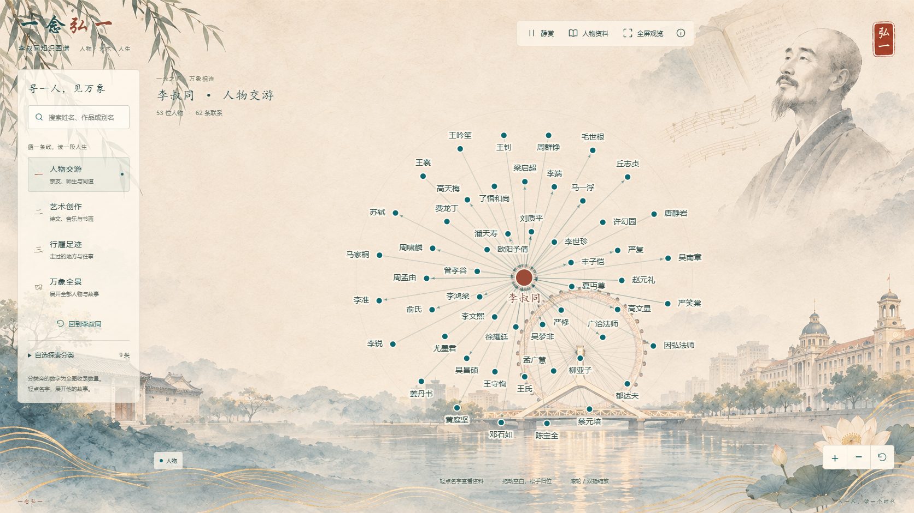

# 一念弘一 · 李叔同知识图谱

一个面向李叔同纪念馆游客观览场景的交互式知识图谱项目。以李叔同为中心，沿着人物交游、艺术创作与人生足迹的连线，探索人物、作品与时代之间的联系。

**[在线体验](https://xiaofirst423.github.io/yinian-hongyi/#/graph)**



## 项目特色

- **四个探索入口**：人物交游、艺术创作、行履足迹与万象全景。
- **搜索与阅读**：支持姓名、作品和别名搜索，点击名字或节点展开资料，继续探索相关人物与事物。
- **舒缓的图谱动效**：节点与标签协调浮动，标签保持稳定；拖动空白区域后，整张图谱会缓缓归位。
- **适合游客观览**：资料卡默认收起，支持静赏、全屏、鼠标缩放和触屏双指缩放。
- **水墨纸色界面**：使用李叔同主题背景，适配桌面、平板和手机。

## 图谱数据

| 内容 | 数量 |
| --- | ---: |
| 人物与事物 | 828 |
| 实体间关系 | 1,479 |
| 资料属性 | 658 |
| 实体类别 | 9 |

默认人物交游视图包含李叔同与 52 位直接关联人物，共 53 个节点、62 条关系。“万象全景”可查看完整图谱。

数据来自项目整理的李叔同知识图谱复核数据。正式输入保存在 `source/`，前端读取 `assets/data/graph-data.json`。属性在资料卡中展示，不重复计为关系边；同名对象保持独立，别名用于搜索。

## 使用方式

1. 选择一个探索主题，或搜索想了解的人物、作品。
2. 点击节点或名字查看资料；点击“展开相关人物与事物”继续探索。
3. 滚轮、双指或右下角按钮缩放图谱。拖动节点可以牵动相邻节点；拖动空白区域后松手，图谱会归位。
4. 使用顶部“静赏”暂停浮动，“人物资料”控制资料卡，“全屏观览”进入全屏。
5. 点击“回到李叔同”恢复默认人物视图。

## 本地运行

项目使用 HTML、CSS、JavaScript 和 Canvas，不依赖前端构建工具或图数据库服务。通过 GitHub Pages 在线访问时无需安装软件。

本地运行需要 Python 3.9 或以上版本：

```bash
git clone https://github.com/xiaofirst423/yinian-hongyi.git
cd yinian-hongyi
python scripts/serve.py start
```

Windows 也可以直接双击 `启动网站.bat`。停止本地服务时，运行以下命令，或双击 `停止网站.bat`：

```bash
python scripts/serve.py stop
```

启动器会自动选择可用端口并打开浏览器。请通过本地服务访问页面，以便正常读取图谱数据。

## 项目结构

```text
index.html                 页面入口
app.js                     图谱绘制与交互
styles.css                 页面与资料卡样式
assets/data/               前端图谱数据
assets/visuals/             背景图片与图标
source/data/               正式输入数据
source/ontology/           类别、关系与属性定义
scripts/                   数据转换、校验与本地启停
docs/                      项目预览图
.nojekyll                  GitHub Pages 静态发布标记
```

## 数据维护与发布

修改正式输入数据后，可重新生成并校验前端图谱：

```bash
python scripts/build_graph_data.py
python scripts/validate_project.py
```

GitHub Pages 使用 `main` 分支根目录发布。将更新提交到 `main` 后，Pages 会自动重新部署。更新页面脚本或样式时，同步更新 `index.html` 中的资源版本标记。

## 联系

项目反馈、内容更正与相关问题可通过 [GitHub Issues](https://github.com/xiaofirst423/yinian-hongyi/issues) 联系。

如有侵权请联系我
